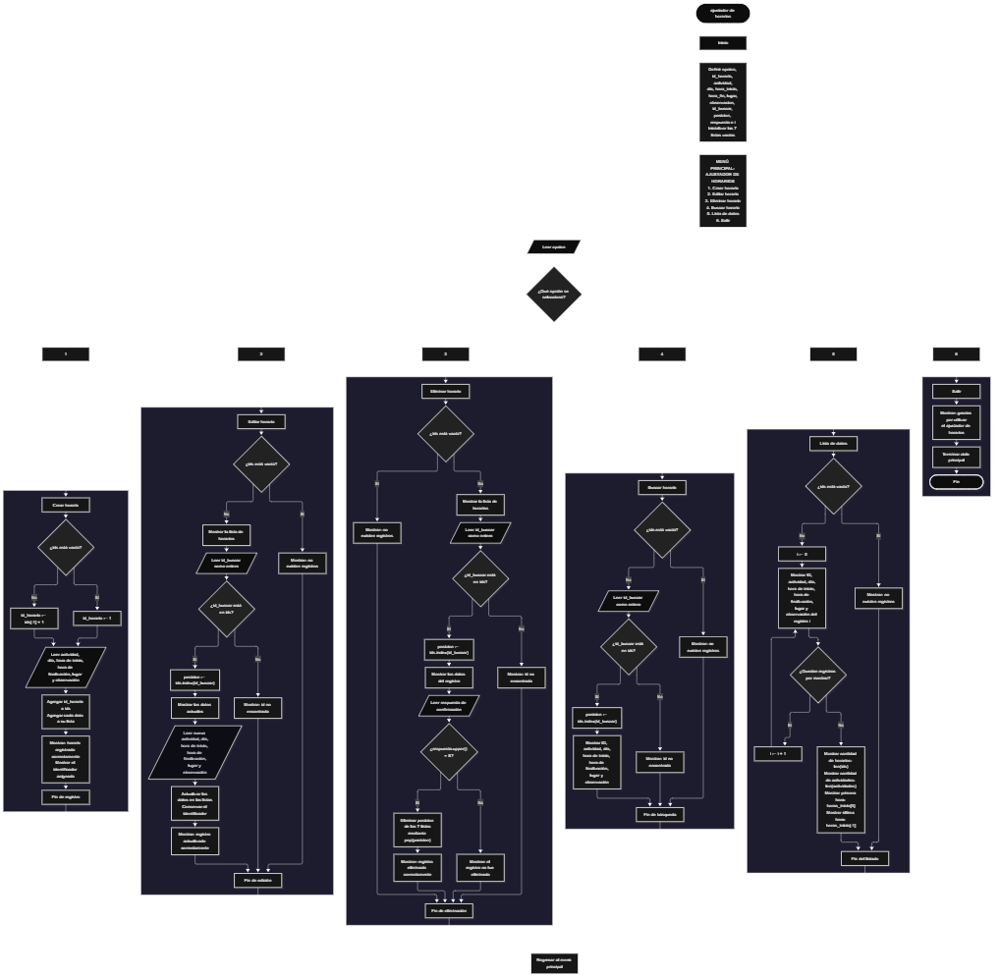

 

Este proyecto, llamado <b>ajustador de horarios</b>, fue desarrollado en <b>python</b> como un ejercicio práctico para fortalecer la lógica de programación mediante la creación de un sistema de gestión de horarios desde la consola. El programa cuenta con un menú principal de seis opciones que permite <b>crear, editar, eliminar, buscar, listar y consultar estadísticas</b> de los horarios registrados. Cada horario almacena datos como el identificador, la actividad, el día, la hora de inicio, la hora de finalización, el lugar y las observaciones. Para organizar esta información, se utilizan siete listas paralelas que mantienen relacionados los datos de cada registro mediante sus posiciones. Durante su desarrollo se aplicaron conceptos fundamentales de programación, como variables, listas, estructuras condicionales, ciclos repetitivos, búsqueda por identificadores y operaciones para crear, consultar, modificar y eliminar registros. Este proyecto permite poner en práctica los conocimientos adquiridos en Python y sirve como base para desarrollar sistemas de gestión más avanzados utilizando otros lenguajes y tecnologías.

<h2 align="center">⚙️ Funcionamiento del menú principal</h2>

### ➕ Crear horario

La opción <b>1) crear horario</b> permite registrar una nueva actividad en el sistema. Antes de almacenar los datos, el programa comprueba si la lista <b>ids</b> está vacía mediante la condición <b>len(ids) == 0</b>. Si no existen registros, asigna el identificador inicial <b>1</b> a la variable <b>id_horario</b>. En caso contrario, genera el siguiente identificador sumando uno al último valor almacenado mediante la expresión <b>ids[-1] + 1</b>. Después, solicita la <b>actividad, día, hora de inicio, hora de finalización, lugar y observación</b>. Los datos se almacenan en sus respectivas listas utilizando el método <b>append()</b>. Finalmente, muestra el mensaje <b>"horario registrado correctamente."</b> y presenta el identificador asignado al nuevo registro.

### ✏️ Editar horario

La opción <b>2) editar horario</b> permite modificar la información de un horario registrado. Primero, el programa comprueba si existen registros mediante la condición <b>len(ids) == 0</b>. Si no hay datos almacenados, muestra el mensaje <b>"no existen registros."</b>. En caso contrario, presenta una lista con el identificador, la actividad, el día, la hora de inicio, la hora de finalización, el lugar y la observación de cada horario. Después, solicita el identificador del registro que se desea editar y lo almacena en la variable <b>id_buscar</b>, convirtiendo la entrada a un número entero mediante <b>int()</b>. Si el identificador se encuentra en la lista <b>ids</b>, obtiene su posición mediante el método <b>index()</b> y muestra los datos actuales. A continuación, solicita los nuevos valores de la actividad, el día, las horas, el lugar y la observación, actualizando directamente las posiciones correspondientes de las listas. El identificador se conserva sin cambios. Finalmente, muestra el mensaje <b>"registro actualizado correctamente."</b>. Si el identificador no existe, presenta el mensaje <b>"id no encontrada."</b>.

### 🗑️ Eliminar horario

La opción <b>3) eliminar horario</b> permite eliminar un horario registrado mediante su identificador. Antes de comenzar, el programa comprueba si existen registros. Si las listas están vacías, muestra el mensaje <b>"no existen registros."</b>. Si hay horarios disponibles, presenta sus datos y solicita el identificador que se desea eliminar. Cuando el identificador existe en la lista <b>ids</b>, obtiene su posición mediante <b>index()</b> y muestra la información del registro seleccionado. Después, solicita una confirmación mediante la pregunta <b>"¿desea eliminar este registro? (s/n):"</b>. La respuesta se convierte a mayúsculas utilizando <b>upper()</b> y se compara con el valor <b>"S"</b>. Si la respuesta coincide, el programa elimina el registro de las siete listas mediante el método <b>pop(posicion)</b>, manteniendo la correspondencia entre los datos. Finalmente, muestra el mensaje <b>"registro eliminado correctamente."</b>. Si el usuario no confirma la operación, presenta el mensaje <b>"el registro no fue eliminado."</b>. Si el identificador no existe, muestra el mensaje <b>"id no encontrada."</b>.

### 🔎 Buscar horario

La opción <b>4) buscar horario</b> permite localizar un registro mediante su identificador. Primero, el programa comprueba si existen horarios almacenados. Si no hay registros, muestra el mensaje <b>"no existen registros."</b>. En caso contrario, solicita el identificador del horario que se desea buscar y almacena el valor en la variable <b>id_buscar</b>. Si el identificador se encuentra en la lista <b>ids</b>, obtiene su posición mediante el método <b>index()</b> y muestra los datos completos del registro: identificador, actividad, día, hora de inicio, hora de finalización, lugar y observación. Si el identificador no se encuentra, presenta el mensaje <b>"id no encontrada."</b>. Esta operación permite consultar un horario específico sin necesidad de recorrer visualmente todos los registros.

### 📋 Lista de datos

La opción <b>5) lista de datos</b> permite visualizar todos los horarios registrados y consultar las estadísticas generales del sistema. Primero, el programa comprueba si la lista <b>ids</b> está vacía. Si no existen registros, muestra el mensaje <b>"no existen registros."</b>. Si hay datos disponibles, utiliza un ciclo <b>for</b> para recorrer las posiciones de las listas y mostrar el identificador, la actividad, el día, la hora de inicio, la hora de finalización, el lugar y la observación de cada horario. Después, presenta el apartado de estadísticas, que incluye la cantidad de horarios registrados mediante <b>len(ids)</b>, la cantidad de actividades mediante <b>len(actividades)</b>, la hora de inicio del primer registro mediante <b>horas_inicio[0]</b> y la hora de inicio del último registro mediante <b>horas_inicio[-1]</b>. Estas dos últimas estadísticas corresponden al orden actual de los registros almacenados y no necesariamente al orden cronológico de las actividades.

### 🚪 Salir del menú principal

La opción <b>6) salir</b> permite finalizar la ejecución del programa. Cuando el usuario selecciona esta opción, el sistema muestra el mensaje <b>"gracias por utilizar el ajustador de horarios."</b> y ejecuta la instrucción <b>break</b>, que interrumpe el ciclo principal <b>while True</b>. De esta manera, el menú deja de mostrarse y el programa termina su ejecución. Si el usuario introduce una opción que no corresponde a las seis alternativas disponibles, el programa muestra el mensaje <b>"opción no válida."</b> y vuelve a presentar el menú principal.

<h2 align="center">🧠 Temas aplicados en el proyecto</h2>

### 📦 Variables

En este proyecto se utilizan variables para almacenar temporalmente la información introducida por el usuario, controlar las opciones del menú, generar identificadores y localizar los registros que se desean consultar, modificar o eliminar. Cada variable cumple una función específica dentro de las operaciones de gestión de horarios.

🔢 **Opcion:** Almacena la opción seleccionada por el usuario en el menú principal.

🆔 **Id_horario:** Almacena el identificador asignado al nuevo horario que se registra.

📝 **Actividad:** Almacena el nombre o descripción de la actividad programada.

📅 **Dia:** Almacena el día indicado para la actividad.

🕒 **Hora_inicio:** Almacena la hora de inicio del horario.

🕘 **Hora_fin:** Almacena la hora de finalización del horario.

📍 **Lugar:** Almacena el lugar donde se realizará la actividad.

📄 **Observacion:** Almacena información adicional sobre el horario registrado.

🔎 **Id_buscar:** Almacena el identificador introducido por el usuario para localizar un registro.

🔄 **Posicion:** Almacena el índice del registro encontrado dentro de la lista de identificadores.

🔁 **I:** Funciona como contador en los ciclos <b>for</b> utilizados para recorrer y mostrar los registros.

### 🗃️ Listas

En este proyecto se utilizan siete listas paralelas para almacenar la información correspondiente a cada horario. Todas las listas mantienen una relación mediante sus posiciones, de modo que los elementos ubicados en un mismo índice pertenecen al mismo registro. Por ejemplo, los elementos situados en la posición <b>0</b> de las siete listas representan los datos del primer horario almacenado. Esta organización facilita agregar, consultar, modificar, eliminar y mostrar los registros.

🆔 **Ids:** Almacena los identificadores de los horarios registrados.

📝 **Actividades:** Almacena los nombres o descripciones de las actividades.

📅 **Dias:** Almacena los días programados para cada actividad.

🕒 **Horas_inicio:** Almacena las horas de inicio de los horarios.

🕘 **Horas_fin:** Almacena las horas de finalización de los horarios.

📍 **Lugares:** Almacena los lugares donde se desarrollarán las actividades.

📄 **Observaciones:** Almacena las observaciones adicionales de cada horario.

### 🔀 Estructuras condicionales

En este proyecto se utilizan las estructuras <b>if</b>, <b>elif</b> y <b>else</b> para controlar las operaciones del sistema. Estas condiciones permiten determinar qué opción del menú seleccionó el usuario, comprobar si existen horarios registrados, verificar si un identificador se encuentra en la lista <b>ids</b>, decidir si un registro debe eliminarse y mostrar mensajes cuando una búsqueda no encuentra coincidencias o cuando se introduce una opción no válida. De esta manera, el programa ejecuta diferentes instrucciones según las condiciones que se cumplen durante su funcionamiento.

### 🔄 Estructuras repetitivas

En este proyecto se utilizan los ciclos <b>while</b> y <b>for</b>. El ciclo <b>while True</b> mantiene activo el menú principal hasta que el usuario selecciona la opción de salida, momento en el que la instrucción <b>break</b> finaliza la repetición. Por otro lado, los ciclos <b>for</b> permiten recorrer las listas y mostrar los datos de los horarios almacenados durante las operaciones de edición, eliminación y listado. Estas estructuras facilitan la repetición de instrucciones sin tener que escribirlas nuevamente para cada registro.

### 🎯 Estructura de selección

El programa utiliza una cadena de condiciones <b>if</b> y <b>elif</b> para seleccionar la operación correspondiente al valor almacenado en la variable <b>opcion</b>. Cada alternativa representa una función específica del sistema: <b>crear, editar, eliminar, buscar, listar datos o salir</b>. Finalmente, la estructura <b>else</b> permite responder cuando el usuario introduce una opción que no coincide con ninguna de las alternativas disponibles, mostrando el mensaje <b>"opción no válida."</b>.

### 🔍 Búsqueda por identificador

El programa utiliza los identificadores para localizar los horarios almacenados. La expresión <b>id_buscar in ids</b> permite comprobar si el identificador introducido pertenece a la lista de registros. Cuando existe, el método <b>ids.index(id_buscar)</b> obtiene la posición correspondiente, que se utiliza para acceder a los datos de las demás listas. Este procedimiento se aplica en las operaciones de edición, eliminación y búsqueda, permitiendo identificar el registro que se desea administrar.

### 🔄 Gestión de listas paralelas

Las listas paralelas permiten distribuir la información de cada horario en diferentes listas relacionadas entre sí. Al crear un registro, el programa utiliza <b>append()</b> para añadir los datos a sus respectivas listas. Al editarlo, actualiza los elementos de la posición encontrada. Al eliminarlo, utiliza <b>pop(posicion)</b> en cada una de las siete listas. De esta manera, los identificadores, las actividades, los días, las horas, los lugares y las observaciones mantienen la correspondencia entre sus posiciones durante las operaciones del sistema.

### 📊 Estadísticas

El programa utiliza la función <b>len()</b> y los índices de las listas para obtener información general sobre los horarios registrados. La expresión <b>len(ids)</b> permite conocer la cantidad de horarios almacenados, mientras que <b>len(actividades)</b> muestra la cantidad de actividades registradas. Por otro lado, <b>horas_inicio[0]</b> obtiene la hora de inicio del primer registro y <b>horas_inicio[-1]</b> obtiene la hora de inicio del último registro. Estas estadísticas se muestran en la opción de listado de datos y reflejan el contenido y el orden actual de las listas.

<h2 align="center">¿Cómo se implementaron las operaciones crud en el proyecto?</h2>

Las operaciones <b>crud</b> se implementaron mediante las opciones del menú principal, permitiendo administrar los horarios registrados. La operación <b>crear</b> corresponde a <b>crear horario</b>, donde se solicitan los datos de una nueva actividad y se almacenan en las siete listas; <b>leer</b> se realiza mediante las opciones <b>buscar horario y lista de datos</b>, que permiten consultar un registro específico o visualizar todos los horarios almacenados; <b>actualizar</b> corresponde a <b>editar horario</b>, donde se modifican los datos de un registro existente; y <b>eliminar</b> se realiza mediante la opción <b>eliminar horario</b>, que solicita confirmación antes de retirar el registro de las listas. Estas operaciones utilizan variables, listas, condicionales y ciclos para gestionar la información durante la ejecución del programa.

<h2 align="center">Diagrama de flujo del proyecto</h2>

<h2 align="center">🛡️ Validaciones del programa</h2>

### 📭 No existen registros

Esta comprobación se utiliza en las opciones de <b>editar, eliminar, buscar y lista de datos</b>. El programa verifica si la lista <b>ids</b> está vacía mediante la condición <b>len(ids) == 0</b>. Si no existen horarios almacenados, muestra el mensaje <b>"no existen registros."</b> y no continúa con la operación solicitada. De esta manera, evita intentar acceder a los datos de un registro cuando las listas no contienen información.

### ❌ Identificador no encontrado

Esta comprobación se utiliza durante las operaciones de <b>editar, eliminar y buscar horario</b>. El programa verifica si el identificador introducido se encuentra en la lista <b>ids</b> mediante la expresión <b>id_buscar in ids</b>. Si existe, obtiene su posición y continúa con la operación correspondiente. Si no existe, muestra el mensaje <b>"id no encontrada."</b>, indicando que no se localizó el registro solicitado.

### ⚠️ Confirmación de eliminación

Antes de eliminar un horario, el programa solicita una confirmación mediante la variable <b>respuesta</b>. La expresión <b>respuesta.upper() == "S"</b> permite aceptar la letra <b>s</b> tanto en mayúscula como en minúscula. Si la condición se cumple, el programa elimina el registro de todas las listas. En caso contrario, conserva la información y muestra el mensaje <b>"el registro no fue eliminado."</b>. Esta comprobación permite evitar que la eliminación se realice sin la confirmación requerida por el programa.

### 🚫 Opción no válida

La estructura condicional <b>else</b> del menú principal controla las opciones que no corresponden a los valores disponibles. Cuando el usuario introduce una opción diferente de <b>1, 2, 3, 4, 5 o 6</b>, el programa muestra el mensaje <b>"opción no válida."</b> y vuelve al inicio del ciclo para presentar nuevamente el menú.

### ⚠️ Entrada del identificador

En las operaciones de edición, eliminación y búsqueda, el programa utiliza la función <b>int()</b> para convertir el identificador introducido por el usuario a un número entero. Sin embargo, el código no incorpora un manejo de excepciones para controlar entradas que contengan letras u otros caracteres que no puedan convertirse a un entero. Tampoco valida el formato de las horas, los días ni que la hora de finalización sea posterior a la hora de inicio. Por lo tanto, estas comprobaciones adicionales no forman parte de la versión actual del programa.

### 🔢 Organización de los registros

El programa mantiene la relación entre los datos mediante siete listas paralelas y utiliza la misma posición para almacenar la información de cada horario. Durante la eliminación, el método <b>pop(posicion)</b> se ejecuta en todas las listas para retirar los datos del registro seleccionado. No obstante, el identificador del siguiente horario se calcula a partir del último identificador que permanece almacenado. Por esta razón, si se elimina el último registro y posteriormente se crea otro, el programa podría reutilizar un identificador que ya había sido eliminado.

<h2 align="center">🎯 Objetivo del proyecto</h2>

El objetivo principal de este proyecto es fortalecer la <b>lógica de programación</b> mediante el desarrollo de un sistema de gestión de horarios en <b>python</b>. A través de su construcción se busca aplicar los conocimientos adquiridos sobre variables, listas, estructuras condicionales, ciclos repetitivos y búsqueda por identificadores, integrándolos para resolver un problema de organización de actividades. Además, el proyecto permite comprender cómo crear, consultar, modificar y eliminar registros mediante listas paralelas, estableciendo una base para desarrollar sistemas de gestión más completos con otros lenguajes y tecnologías.

